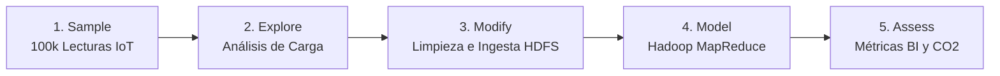
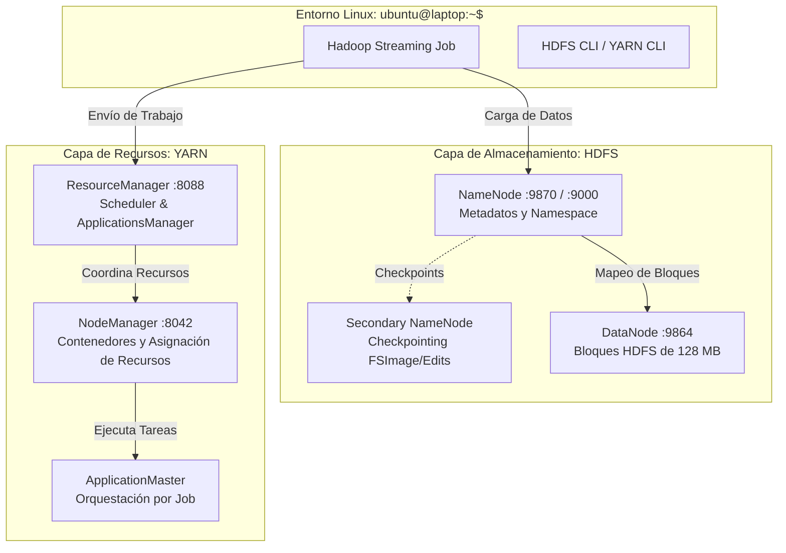

# ⚡ Proyecto Final: Procesamiento Distribuido Big Data con Apache Hadoop (HDFS, YARN y MapReduce) Aplicando Metodología SEMMA


Proyecto integral de **Inteligencia de Negocios y Big Data** enfocado en la implementación, optimización y evaluación de un clúster distribuido de **Apache Hadoop (HDFS, YARN y MapReduce)**. Se aplica la metodología **SEMMA** (*Sample, Explore, Modify, Model, Assess*) para procesar masivamente flujos de telemetría IoT de redes eléctricas inteligentes (**Smart Grids**) y estimar la huella de carbono sectorial ($kg\ CO_2$).

---

## 📋 Tabla de Contenidos
1. [Objetivos y Metodología SEMMA](#-objetivos-y-metodología-semma)
2. [Arquitectura del Sistema](#-arquitectura-del-sistema)
3. [Estructura del Proyecto](#-estructura-del-proyecto)
4. [Requisitos Previos](#-requisitos-previos)
5. [Despliegue Rápido (Quickstart)](#-despliegue-rápido-quickstart)
6. [Configuración y Optimización de Hadoop](#-configuración-y-optimización-de-hadoop)
7. [Diagnóstico y Resolución de Problemas Complejos](#-diagnóstico-y-resolución-de-problemas-complejos)
8. [Resultados y Análisis de Sostenibilidad](#-resultados-y-análisis-de-sostenibilidad)
9. [Interfaces Web de Monitoreo](#-interfaces-web-de-monitoreo)
10. [Autor e Información Académica](#-autor-e-información-académica)

---

## 🎯 Objetivos y Metodología SEMMA

El proyecto cumple con los lineamientos del **Objetivo 1.1** de la actividad académica, articulando la gestión de recursos de software con el análisis estratégico empresarial:



* **1. Sample (Muestreo):** Extracción estratificada de 100,000 registros de sensores inteligentes distribuidos en cinco zonas representativas (Zona Norte, Zona Sur, Zona Este, Zona Oeste y Distrito Industrial).
* **2. Explore (Exploración):** Detección de patrones temporales, horas pico (18:00 a 23:00 h) y cálculo del *Load Factor* (Factor de Carga = 0.47 en residencial vs carga continua industrial).
* **3. Modify (Modificación):** Normalización de voltajes bajo norma técnica **IEC 60038** ($\pm 10\%$ de 220V), cálculo de emisiones de $CO_2$ ($0.42\ kg/kWh$) y preparación del dataset para el sistema HDFS.
* **4. Model (Modelado):** Ejecución de algoritmo distribuido mediante Hadoop Streaming (`mapper.py` y `reducer.py`) para agregación paralela y cálculo de totales y promedios por zona.
* **5. Assess (Evaluación):** Auditoría de contadores YARN (vCore-ms, MB-ms) y formulación de estrategias de eficiencia energética (*Peak Shaving* y *Demand Response*).

---

## 🏛 Arquitectura del Sistema

El entorno se despliega de forma nativa sobre Linux utilizando un contenedor optimizado basado en **Ubuntu 22.04 LTS** con `OpenJDK 11` y `Hadoop 3.3.6`:



---

## 📁 Estructura del Proyecto

```text
IN-sem15/
├── config/                      # Archivos de configuración optimizados de Hadoop
│   ├── core-site.xml            # Sistema de archivos por defecto y buffers de I/O
│   ├── hdfs-site.xml            # Bloques HDFS de 128MB, replicación y puertos web
│   ├── yarn-site.xml            # Gestión de RAM (3 GB), ShuffleHandler y vmem checks
│   ├── mapred-site.xml          # Configuración de memoria de Mappers/Reducers en YARN
│   ├── hadoop-env.sh            # Variables de entorno JVM y supresión de warnings
│   └── log4j.properties         # Configuración de logs y filtros de salida
├── dataset/                     # Generación y manipulación de datos
│   └── generate_energy_dataset.py # Generador sintético de 100,000 registros Smart Grid
├── mapreduce/                   # Algoritmos de cómputo distribuido
│   ├── mapper.py                # Extracción y particionado de métricas por zona
│   └── reducer.py               # Agregación de consumos y cálculo de emisiones
├── Dockerfile                   # Construcción de la imagen Ubuntu 22.04 + Hadoop 3.3.6
├── docker-compose.yml           # Orquestación del contenedor y mapeo de puertos
├── entrypoint.sh                # Script de inicio del contenedor (SSH y soporte)
├── run_pipeline.sh              # Script maestro automatizado de ejecución de punta a punta
├── generate_final_report.py     # Generador automatizado del informe Word y PDF
├── in-lab15-fso-resuelto.docx   # Documento Word oficial con desarrollo exhaustivo
├── in-lab15-fso-resuelto.pdf    # Documento PDF final listo para entrega
├── .gitignore                   # Exclusión de binarios y datos pesados
└── README.md                    # Documentación técnica completa del repositorio
```

---

## ⚙ Requisitos Previos

* **Docker Desktop** (versión 20.10 o superior) con backend WSL2 activo en Windows.
* **Git** (para control de versiones).
* **Python 3.8+** (opcional para generación local de datos y compilación de informes).

---

## 🚀 Despliegue Rápido (Quickstart)

### 1. Clonar el Repositorio
```bash
git clone https://github.com/Dorian-devw/IN-lab15.git
cd IN-lab15
```

### 2. Levantar el Clúster de Hadoop en Docker
```bash
docker compose up -d
```

### 3. Ingresar a la Terminal Nativa de Linux
```bash
docker exec -it hadoop-master bash
```
*Se mostrará el prompt interactivo:*
```text
ubuntu@laptop:~$
```

### 4. Ejecutar el Pipeline Completo
Dentro del contenedor, ejecuta el script maestro automatizado:
```bash
bash /home/ubuntu/run_pipeline.sh
```
*Este comando formateará el NameNode (si no lo está), iniciará HDFS y YARN, subirá los 100,000 registros a `/smart_grid/input` y ejecutará el job MapReduce.*

---

## 🔧 Configuración y Optimización de Hadoop

Para maximizar el rendimiento y optimizar el entorno de ejecución, se calibraron parámetros específicos de bajo nivel:

| Archivo | Parámetro | Valor Configurado | Justificación Técnica de Rendimiento |
| :--- | :--- | :---: | :--- |
| `core-site.xml` | `io.file.buffer.size` | `131072` (128 KB) | Incrementa el throughput secuencial de E/S minimizando llamadas al sistema (`sys_read`). |
| `hdfs-site.xml` | `dfs.blocksize` | `134217728` (128 MB) | Reduce drásticamente la cantidad de metadatos en memoria RAM del NameNode (~150 bytes/bloque). |
| `hdfs-site.xml` | `dfs.replication` | `1` | Factor de réplica óptimo para entornos de laboratorio pseudo-distribuidos. |
| `yarn-site.xml` | `yarn.nodemanager.resource.memory-mb` | `3072` (3 GB) | Capacidad de memoria RAM física total que NodeManager puede asignar a contenedores. |
| `yarn-site.xml` | `yarn.nodemanager.vmem-check-enabled` | `false` | Previene que el gestor de memoria virtual de Linux (`glibc`) aborte tareas en Docker. |
| `mapred-site.xml`| `mapreduce.map/reduce.memory.mb` | `1024` (1 GB) | Memoria física máxima por contenedor Map y Reduce. |
| `mapred-site.xml`| `mapreduce.map/reduce.java.opts` | `-Xmx800m` | Fija el heap de la JVM en 800 MB, reservando 224 MB para la memoria nativa de Python. |

---

## 🛠 Diagnóstico y Resolución de Problemas Complejos

### Problema Diagnosticado: Falla de Tokenización SSH por Advertencias en stdout
* **Síntoma:** Al arrancar el clúster con `start-dfs.sh`, el comando interno `hdfs getconf -namenodes` emitía en `stdout`:
  ```text
  WARN NativeCodeLoader:60 - Unable to load native-hadoop library for your platform...
  ```
  El script realizaba una iteración palabra por palabra sobre dicha salida, intentando conectarse vía SSH a nombres de host inválidos (`ssh unable`, `ssh to`, `ssh native-hadoop`), abortando el despliegue.
* **Solución Aplicada:**
  1. En `log4j.properties` se configuró el filtro:
     ```properties
     log4j.logger.org.apache.hadoop.util.NativeCodeLoader=ERROR
     ```
  2. En `hadoop-env.sh` se exportó:
     ```bash
     export HADOOP_OPTS="-Dlog4j.logger.org.apache.hadoop.util.NativeCodeLoader=ERROR $HADOOP_OPTS"
     export HDFS_NAMENODE_USER=ubuntu
     export HDFS_DATANODE_USER=ubuntu
     export YARN_RESOURCEMANAGER_USER=ubuntu
     export YARN_NODEMANAGER_USER=ubuntu
     ```
  Esto limpió el canal de `stdout`, permitiendo que `getconf` devuelva únicamente `localhost` y asegurando el inicio limpio de los daemons.

---

## 📊 Resultados y Análisis de Sostenibilidad

La ejecución distribuida del job MapReduce procesó los **100,000 eventos** generando los siguientes resultados consolidados en HDFS:

```bash
ubuntu@laptop:~$ hdfs dfs -cat /smart_grid/output/part-*
```

```text
Zona                Lecturas    Consumo_Total_kWh   Consumo_Promedio_kWh    Emisiones_CO2_kg
Distrito_Industrial 20025       3590338.65          179.29                  1507942.23
Zona_Este           20043       326833.44           16.31                   137270.05
Zona_Norte          20002       57436.07            2.87                    24123.15
Zona_Oeste          19896       324426.13           16.31                   136258.97
Zona_Sur            20034       57747.35            2.88                    24253.89
```

### 💡 Hallazgos de Business Intelligence
* **Concentración Crítica de Demanda:** El **Distrito Industrial** representa el **82.5%** del consumo energético total y genera más de **1,507 toneladas de $CO_2$**.
* **Estrategias Sostenibles:**
  1. **Peak Shaving:** Desplazar las cargas pesadas hacia horas valle donde predomina la generación de fuentes renovables (solar/eólica).
  2. **Green Computing:** Implementar suspensión dinámica de nodos en YARN durante periodos de inactividad para reducir la huella energética del propio clúster analítico.
  3. **Privacidad de Smart Meters:** Aplicación de *Privacidad Diferencial* en los Mappers para salvaguardar la intimidad de los hogares frente a técnicas de desagregación de carga (*NILM*).

---

## 🌐 Interfaces Web de Monitoreo

Con el clúster activo, puedes acceder a las UIs de Hadoop directamente en tu navegador:

* 📊 **HDFS NameNode (Salud y Almacenamiento):** [http://localhost:9870](http://localhost:9870)
* 📁 **Explorador del Sistema de Archivos HDFS:** [http://localhost:9870/explorer.html#/smart_grid](http://localhost:9870/explorer.html#/smart_grid)
* 🚀 **YARN ResourceManager (Historial de Jobs):** [http://localhost:8088/cluster](http://localhost:8088/cluster)

---

## 👨‍💻 Autor e Información Académica

* **Estudiante:** Frank Sinca
* **Escuela:** Tecnología Digital - Tecsup
* **Curso:** Inteligencia de Negocios
* **Docente:** Jurgen Alvarez
* **Ciclo:** Sexto Ciclo
